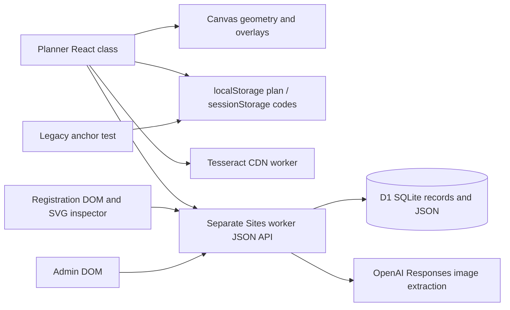
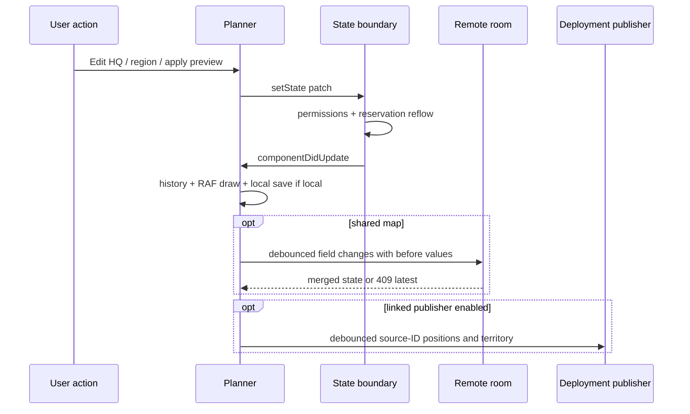

# Implemented architecture

The planner is an embedded React class (`Planner`) with a large flat state object. Canvas drawing and geometry functions sit beside roster import, region clipping, room networking, permissions and panel rendering in the same HTML file. The registration and admin pages use their own native DOM render/bind cycles and inline CSS; they do not import planner components. The backend worker is maintained/deployed separately. [Symbol index](source-symbol-index.json), [capability sources](03-feature-catalogue.md), [worker](evidence/shared-service/worker/index.js).

## Responsibilities and coupling

| Layer | Symbols / evidence | Consequence |
|---|---|---|
| Geometry | `disk`, `distance`, `capitalCells`, `hexOuterEdges`, `geomStatus`, `canShield` | Must preserve odd-r parity and centre-vs-footprint distinction |
| Strategic polygons | region normalisation, polygon-clipping, `reflowReservedRegions`, `generateAllianceLayout` | Manual reservations and layout editing are interdependent |
| Placement | `applyCellTap`, `deployPoolAt`, `quickDeployFits`, `applyQuickDeployment` | Shared eligibility checks must survive moving buttons/panels |
| State boundary | overridden `setState`, `componentDidUpdate`, `planSnapshot` | A UI change can trigger reflow, history, saves and publishing |
| Collaboration | `flushRoomChanges`, `pollSharedRoom`, `syncRosterSource` | Two polling relationships with different merge semantics |
| Registration UI | `registrationBody`, `saveRow`, `render`, `refreshRegistrationLive` | Full response preservation and event rebinding are part of quick toggles |
| Backend | `cleanPlan`, `applyChanges`, `commitPlan`, `registration`, `writeDeployment` | Server roles/version checks supplement client logic |

`componentDidUpdate` records history, queues shared changes, may queue deployment publishing, requests drawing and saves local state. `setState` itself can reflow regions and reject unauthorized changes. A render or navigation refactor that bypasses these update paths can change behaviour without touching a geometry function.

## Rendering and lifecycle

Main canvas is imperative and queued through `paintSoon`; React renders controls and dialogs. Map pixels depend on canvas dimensions, radius and pan; world points for freeform regions use a distinct half-row-offset representation. Registration SVG recreates map markup, retains inspector state in a memory Map and binds interaction handlers. Admin replaces markup and binds buttons after authenticated fetches. Cleanup/cancellation includes timers, RAF/async epochs, OCR abort and drag/touch state; tests mostly stub these and do not establish native lifecycle correctness.

## Hidden or duplicated implementation

`renderLayoutGroups` survives alongside applied-layout controls; legacy anchor-test embeds an older planner. Registration and planner duplicate coordinate/map depiction and status derivation concerns; admin and planner expose overlapping room-code operations through different authority. Shared backend runtime creates deployment storage separately from its checked-in initial SQL migration. The generated monolithic HTML lacks a committed reproducible authoring/build pipeline; historical workspace generators are outside this Git baseline. These are observations, not proposed replacements.
