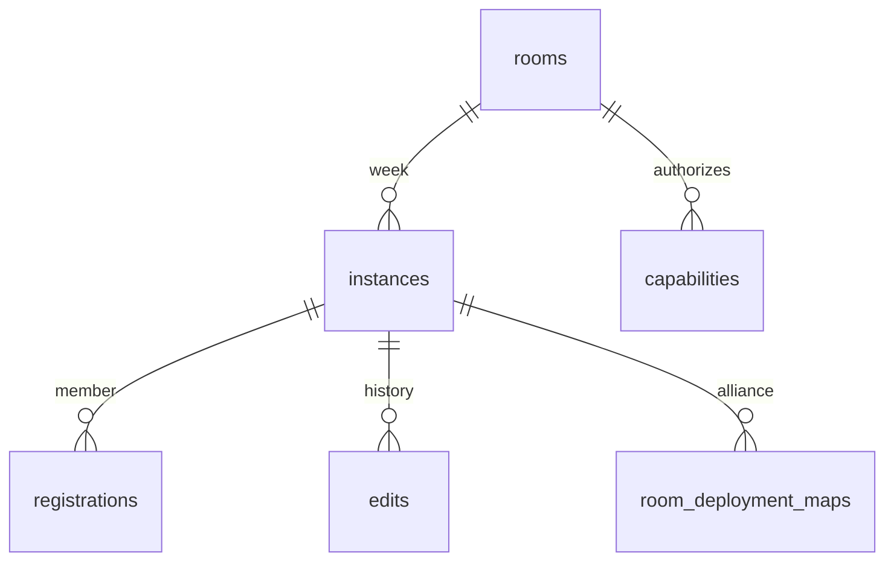

# Data models and invariants

Evidence: [planner](../../acm1-planner/index.html) `planSnapshot`, `normaliseRegions`, `mergeRosterSource`, `importJSON`; [worker](evidence/shared-service/worker/index.js) `cleanPlan`, `registration`, `writeDeployment`, `selfEnroll`; [SQL](evidence/shared-service/drizzle/0000_rooms.sql). These are implemented JavaScript/JSON shapes, not a newly imposed schema.

## Core JSON shapes

| Model | Fields and semantics | Transformations / constraints |
|---|---|---|
| Placed HQ (`homes[]`) | `id,name,x,y,alliance,colour,level,locked,hasMoved`; optional source mapping and enrollment metadata | Integer centre; radius-one footprint seven cells. Level normally optional or integer 1–99 in UI; backend does not enforce all UI metadata constraints |
| Waiting player (`pool[]`) | Identity/metadata without required centre | Deploy moves to homes retaining ID. Recall removes x/y/lock/arrival; imported JSON may regenerate ID |
| Linked player | `rosterSourceRoomId`, `rosterSourceMemberId`, `rosterStatus`; source week resides in rosterLink | Exact source ID matching first; name/alliance fallback. Local ID is not always source member ID |
| Region | `id,name,points:[{x,y}],colour,opacity`, optional `parts`, `layout`, `ownerAlliance` | >=3 points; polygon parts include outer rings/holes. Layout metadata links group/order/share/tier/rotation/visibility; do not flatten into points alone |
| Plan | `homes,pool,regions,outer,inner,excludedCells,anchorId` | Shared change/history boundary. Outer/inner are arrays of `[x,y]`; exclusions `{x,y}`; anchor nullable |
| Preview | Source signature, proposed placements, counts/leftovers and cancellation token | Transient; not committed plan until apply and revalidation |
| Registration | Member-keyed body `status,placement,role,windows,notes` plus version/update identity | Status availability distinct from roster approval. Windows store numeric hour intervals relative to event start; quick actions preserve existing custom fields |
| Enrollment | Member identity, alliance, enrollment review metadata | Pending excluded from automatic registered deployment until approve/merge; reject/remove changes roster, not merely response |
| Capability | `id,room_id,role,alliance,label,code_hash,code,revoked,created_at` | Bearer codes, no individual identity. Hash normalized code; plaintext retained server-side for authorized reveal |
| Room | `id,name,config,current_week,created_at` | Config registration/weekly/allianceAccess booleans; lifecycle closed metadata added by admin path |
| Instance | Room+week plan JSON, version, mutation ID, timestamps/archive | Archived instances immutable through current edit routes |
| Published map | Room+week+normalized alliance, version, geometry/regions/members | Stable source member IDs, assigned x/y; remembers prior centre and updated state on changes |

Backend `cleanPlan`: homes/pool <=2,000 **each**, regions <=500; unique nonempty string IDs <=160 **within each collection**, names <=160, alliance <=120; homes coordinates integer magnitude <=10,000; region 3–100 finite points magnitude <=1e6. Outer/inner each 3–100 finite coordinate pairs; excluded cells <=10,000 integer pairs. Serialized plan <=700,000 characters. It clones metadata rather than whitelisting all fields. It does **not** validate physical overlap, game exclusions, cross-collection duplicate IDs or all optional region-part invariants. General API body cap is 900,000 characters; AI has separate limits.

## Geometry

Odd-r axial q=`x-(y-(y&1))/2`, r=`y`; hex distance is max of absolute cube-coordinate differences. Render x includes half a column for odd rows. Capital exclusion and mud membership derive inclusive sets of cells whose centres belong to the polygons; thick perimeter cancels internal hex edges. `geomStatus` checks every radius-one cell against exclusion sets/turrets/manual blocks, then HQ distance <3. It does not prohibit grass or force full HQ containment in an alliance allocation.

Defaults: outer `[[482,465],[517,465],[535,500],[517,535],[482,535],[465,500]]`; inner `[[491,483],[508,483],[517,500],[508,517],[491,517],[483,500]]`. These and the provisional coordinate hypothesis are not externally verified game guarantees. Fixed turret vertices are preserved in source `TURRETS` and [CAP-006](03-feature-catalogue.md#cap-006--defined-turret-exclusions).

## SQL relationships

The diagram expresses logical relationships, not an assertion that every arrow is a declared SQL foreign key. `rate_limits(key,count)` also stores permanent cost ledger, so it is not safe to purge it wholesale as transient rate-limit data. Deployment table is runtime-created by `deploymentSchema`, absent from initial migration. Exact columns are in [schema](evidence/shared-service/drizzle/0000_rooms.sql) and worker `deploymentSchema`.

## Identity and compatibility hazards

`rosterKey` (name dedup), `roomTag` (shared matching), and `rosterAllianceKey` (sidebar grouping) use different normalization policies. Source fallback also uses NFC case-sensitive trimmed player name plus normalized alliance. Unicode, punctuation, whitespace, case and IDs are part of the contract; do not globally “clean” names. Region label matching does not create a single authoritative alliance entity table. Export/import reconstructs whitelisted fields and is not a lossless linked-roster migration. JSON, browser state and server state have different shapes and validation; see [persistence](06-state-and-persistence.md).
