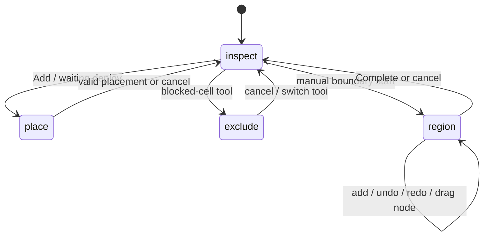
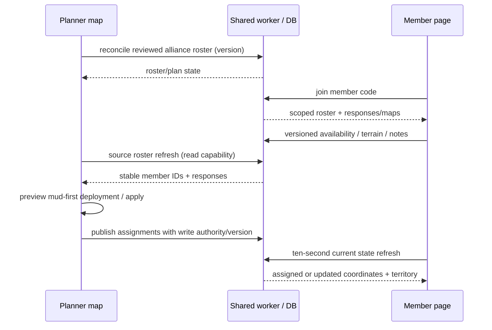

# Behavioural specifications and event flows

These flows describe the **implemented** path, including awkward transitions. Source symbols are indexed in [registry](feature-registry.json); [API](04-api-contracts.md), [state](06-state-and-persistence.md) and [test matrix](traceability-matrix.csv) supply detailed contracts. No proposed workflow is substituted for the baseline.

## Mode and task precedence

`mode` is not the whole interaction state. `moveHQId`, selected pool player, region draft/edit/drag, `panelKind`, tool tab, mobile panel and pending confirmation can override handling within a mode. Native drag/pointer/touch state also gates polling and hit tests. Read `applyCellTap`, `mouseDown/move/up`, touch handlers, `keyDown`, `cancelTask` and `setState` together. Read-only/archive/closed guards apply beyond mere button visibility.

## FLOW-01 — Local bootstrap, resume and Welcome

- **Entry and trigger:** Planner constructor/componentDidMount; page load.
- **Preconditions / input:** Browser storage parseable or empty. A hash/session room may trigger remote resume.
- **Transitions and functions:** load → exact demo/ring migration → normalise regions → draw and optional Welcome; shared boot takes precedence when supplied.
- **Validation, failure and recovery:** Malformed JSON becomes blank fallback; malformed but parseable shapes are not comprehensively migrated. Welcome choice opens tutorial then task; skip state changes only preference.
- **Side effects, success and dependencies:** Local save separate from session; opening a panel must not imply plan mutation.
- **Capability trace:** CAP-060,CAP-066,CAP-067; source/test links in [catalogue](03-feature-catalogue.md).

## FLOW-02 — Add, move, lock and arrive

- **Entry and trigger:** + Add, highlighted cell, empty-cell context menu, HQ context menu or details.
- **Preconditions / input:** Editable map; coordinate valid; move not position-locked.
- **Transitions and functions:** openAddPlayer / openCellMenu → collect identity/colour/level → choose cell or coordinates → geomStatus → addHQ/deployPoolAt/updateHQ → state update.
- **Validation, failure and recovery:** Invalid footprint reports reasons without committing; Escape cancels task. Confirm moved sets hasMoved, not registration response. Delete uses removal confirmation where wired.
- **Side effects, success and dependencies:** Identity remains stable for movement; full footprint exclusions and HQ overlap differ from alliance centre-only rule.
- **Capability trace:** CAP-011–020; source/test links in [catalogue](03-feature-catalogue.md).

## FLOW-03 — Roster drag and live drop preview

- **Entry and trigger:** Native sidebar dragStart/dragOver/drop/end.
- **Preconditions / input:** Waiting player or unlocked placed HQ; coordinator/officer scope; editable nonarchive map.
- **Transitions and functions:** startRosterDrag → rosterDropTarget(pxToCoord) → mapDragOver validity outline/name/HQ/X/Y → mapDrop → deploy/move → cleanup.
- **Validation, failure and recovery:** Blocked target cannot commit; leave/end/cancel removes preview. Touch uses select/deploy paths rather than relying on native desktop drag.
- **Side effects, success and dependencies:** Shared state/publishing may enqueue after accepted move; coordinate preview is transient.
- **Capability trace:** CAP-014,CAP-065; source/test links in [catalogue](03-feature-catalogue.md).

## FLOW-04 — Manual boundary drafting and node editing

- **Entry and trigger:** Manually Draw Boundary button or Adjust corners.
- **Preconditions / input:** Region editing authority; world geometry, independent of physical exclusions.
- **Transitions and functions:** beginRegion seeds capital → first origin click marks feedback → addRegionPoint → click origin to close → finishRegion review → label/colour/opacity → Complete. Existing corner drag uses begin/move/endBoundaryNode.
- **Validation, failure and recovery:** At least three corners, nonselfintersection and point limits; draft undo/redo differs from plan history. Cancel discards draft. Collinear simplification can renumber nodes.
- **Side effects, success and dependencies:** Commit reflows reservations and quick layouts; selected unused colour and grass extension retained in saved shape metadata.
- **Capability trace:** CAP-026–030; source/test links in [catalogue](03-feature-catalogue.md).

## FLOW-05 — Generate, update and compare allocation layouts

- **Entry and trigger:** Quick Layouts panel Generate/Update/Additional Layout.
- **Preconditions / input:** Valid domain around capital; editable region mode; manual reserved shapes.
- **Transitions and functions:** layoutFootprint → subtract reservations → weighted area slices → group metadata/regions → select applied group; live rotation/share/tier/order updates geometry.
- **Validation, failure and recovery:** No available area/invalid domain or locked-share constraints reject or limit allocation. Selected alternate layouts control display; deletion must retain other groups.
- **Side effects, success and dependencies:** Reflow can modify multiple regions from one UI edit. Major/minor, rotation0 physical+90, holes and source IDs are contract.
- **Capability trace:** CAP-031–038; source/test links in [catalogue](03-feature-catalogue.md).

## FLOW-06 — Inspect alliance and reconcile tags

- **Entry and trigger:** Doubleclick region; sidebar alliance filter; assign unassigned action.
- **Preconditions / input:** Visible hit region; no conflicting draw/move mode.
- **Transitions and functions:** regionAtPixel → focusRegion → centre-in-region counts including hole exclusion → matching normalized tags; inline editor updates region immediately.
- **Validation, failure and recovery:** Hidden region/no hit does not select. Blank tags do not become alliance members merely because HQ sits inside polygon. Explicit assignment supports undo.
- **Side effects, success and dependencies:** Stats exclude waiting players; display filter never deletes/reorders underlying roster automatically.
- **Capability trace:** CAP-022,CAP-024,CAP-039; source/test links in [catalogue](03-feature-catalogue.md).

## FLOW-07 — Automatic deployment and recall

- **Entry and trigger:** Alliance Focus Preview deployment / apply / Recall.
- **Preconditions / input:** Waiting matching alliance; optional approved available registration covers whole selected time window; terrain preferences.
- **Transitions and functions:** quickDeployRoster → candidates inside region centres → standard or compact trials with physical footprint validity → mud-first positions → preview signature/token → applyQuickDeployment rechecks → pool to homes.
- **Validation, failure and recovery:** Stale signature, changed exclusions, no space or permissions refuse commit; leftovers retained. Recall confirmed returns all homes including locked/arrived to waiting and clears anchor.
- **Side effects, success and dependencies:** Preview nonmutating; apply/recall plan history. Outer footprint may spill neighbouring allocation but never physical exclusions/other HQ.
- **Capability trace:** CAP-040–047; source/test links in [catalogue](03-feature-catalogue.md).

## FLOW-08 — Screenshot local/AI extraction and review

- **Entry and trigger:** Import screenshots modal choose/drop.
- **Preconditions / input:** Images valid; local worker assets or AI passcode/backend quota available.
- **Transitions and functions:** upload queue → balanced serial AI batches OR local two-pass crops → OCR rows/source evidence → merge/review/edit/confirm → importRosterPool.
- **Validation, failure and recovery:** Abort cancels remaining reads; provider/quotas errors shown. Not-ready rows remain for review. Duplicate names skip or require merge/conflict review. Paid completed work is not undone by cancellation.
- **Side effects, success and dependencies:** Images/passcode transient, local roster added once. It is not shared reconciliation; source mapping and warnings retained as implemented.
- **Capability trace:** CAP-048–054,CAP-099; source/test links in [catalogue](03-feature-catalogue.md).

## FLOW-09 — Shared roster reconciliation after image review

- **Entry and trigger:** Review as shared alliance roster.
- **Preconditions / input:** Officer/coordinator authority; chosen alliance; reviewed member list.
- **Transitions and functions:** useScreenshotRoster → previewRoomRoster → POST reconcile apply:false → added/matched/missing/version → explicit apply → commitPlan.
- **Validation, failure and recovery:** Empty/duplicate names or stale version rejected; replace mode removes missing entries, additive mode does not. Foreign alliance officer denied.
- **Side effects, success and dependencies:** Roster identity/registration association is separate from uploading screenshots. Local Add to roster does not create registration room automatically.
- **Capability trace:** CAP-055; source/test links in [catalogue](03-feature-catalogue.md).

## FLOW-10 — Create or join shared map; leave

- **Entry and trigger:** Rooms & sharing create/join/leave.
- **Preconditions / input:** Valid plan/code; role/feature/lifecycle gates.
- **Transitions and functions:** Create copies local plan → room/codes/state; join applies returned plan and session → polling/save. Leave restores previous local memory or explicit copy locally.
- **Validation, failure and recovery:** Invalid/revoked code error; archived map read-only. Offline pending local draft remains available; do not overwrite newer week blindly.
- **Side effects, success and dependencies:** Join replaces displayed plan, not a roster-source merge. Local autosave suppressed in room.
- **Capability trace:** CAP-067–070; source/test links in [catalogue](03-feature-catalogue.md).

## FLOW-11 — Concurrent editing and offline conflict recovery

- **Entry and trigger:** Editable shared map state update.
- **Preconditions / input:** Current week; legal ownership.
- **Transitions and functions:** snapshot diff → stash draft → debounce flush → before-value patch + order/settings → commitPlan optimistic transaction → latest state/history merge.
- **Validation, failure and recovery:** Unrelated fields merge; same field409 latest. Keep mine/use latest/download draft explicit. Failed network retains draft, newweek requires reload.
- **Side effects, success and dependencies:** Server may persist plan then fail direct snapshot publishing. HTTP500 cannot universally mean no write.
- **Capability trace:** CAP-071–073,CAP-077; source/test links in [catalogue](03-feature-catalogue.md).

## FLOW-12 — Link registration room to independent map

- **Entry and trigger:** Roster sync panel enter registration/room code.
- **Preconditions / input:** Source has registration; destination editable if shared; proper scope.
- **Transitions and functions:** syncRosterSource POST join read → mergeRosterSource stable mapping → waiting imports/response remap; keep destination regions/HQ positions → persist source link →15s refresh.
- **Validation, failure and recovery:** Wrong scope/error prevents registered deployment when enabled; new source week stops automatic switch. Removed waiting dropped, placed flagged; disconnect retains imported data.
- **Side effects, success and dependencies:** Source placements do not overwrite target map. Automatic publishing enable if credentials available is a separate side effect with risk R07.
- **Capability trace:** CAP-078–081; source/test links in [catalogue](03-feature-catalogue.md).

## FLOW-13 — Publish deployment instructions

- **Entry and trigger:** Publishing enable or accepted map mutation.
- **Preconditions / input:** Write code/admin key for matching source room, current week, correct alliance.
- **Transitions and functions:** GET maps validate room/version → queue1s → group source IDs/alliance geometry → POST version → server snapshot assignments → member live refresh.
- **Validation, failure and recovery:** No write authority/wrongroom/staleversion/unknown member/closedroom reports error. Per-alliance loop may partially succeed. Pause stops further queued publishing.
- **Side effects, success and dependencies:** First assigned→deployed; changed prior centre→updated orange; recall→not-deployed; no member acknowledgement on clipboard copy. Source roster and responses unchanged.
- **Capability trace:** CAP-080,CAP-081,CAP-089–091; source/test links in [catalogue](03-feature-catalogue.md).

## FLOW-14 — Member registration quick actions and notes

- **Entry and trigger:** Friendly member link/code page and roster buttons.
- **Preconditions / input:** Registration/alliance access enabled and active code; not closed; member exists.
- **Transitions and functions:** boot joins → scoped roster + responses/maps → availabilityPatch / placement / note → registrationBody preserves rest → saveRow version PUT → rerender/focus and success state.
- **Validation, failure and recovery:** Unavailable clears Before/During; deselecting all yields unanswered.409 shows error and Reload latest before retry; in-flight per-row guards. Closed read-only; refresh skips active gestures/saves as wired.
- **Side effects, success and dependencies:** Availability windows numeric event-relative hours; preference grass/mud is not hasMoved. Ten-second visible refresh.
- **Capability trace:** CAP-082–086,CAP-088; source/test links in [catalogue](03-feature-catalogue.md).

## FLOW-15 — Missing member and officer approval

- **Entry and trigger:** Add missing member in registration; pending review in planner.
- **Preconditions / input:** Name/level1–99; own alliance; officer/coordinator reviews.
- **Transitions and functions:** POST members → existing or new pending → separate registration PUT → pending review approve/reject/merge.
- **Validation, failure and recovery:** Duplicate returns existing ID; pending cap200; merge target same alliance approved. Both entries with responses409 prevents silent response loss.
- **Side effects, success and dependencies:** Enrollment/response are separate calls: first can succeed if second fails. Pending excluded from automatic deployment.
- **Capability trace:** CAP-087,CAP-041; source/test links in [catalogue](03-feature-catalogue.md).

## FLOW-16 — Member live map inspection

- **Entry and trigger:** Your alliance deployment map.
- **Preconditions / input:** Published/derived map available.
- **Transitions and functions:** SVG markup → inspector keyedroom/week/alliance → +/-/wheel/pinch anchored zoom1–20 → clamp/pan/Fit → HQ select → details/copy.
- **Validation, failure and recovery:** No assignment shows Not Deployed; refresh preserves in-memory zoom/selection, but actual gestures/event rebinding not browser-tested. No HQ editing action exists here.
- **Side effects, success and dependencies:** Read-only UI; server GET may seed derived snapshots. New assignments/state from publisher refresh live.
- **Capability trace:** CAP-089–091; source/test links in [catalogue](03-feature-catalogue.md).

## FLOW-17 — Admin inventory, code changes and room copies

- **Entry and trigger:** Admin page with site key.
- **Preconditions / input:** Global key hash configured; not a member/coordinator code.
- **Transitions and functions:** List paginated rooms → expand redacted details → explicit reveal/open/registration URL → issue/replace/revoke code or close/reopen/duplicate.
- **Validation, failure and recovery:** Wrong key401/rate limit; no active coordinator409 open planner; registration disabled409 links; unique revoked labels cannot be reused.
- **Side effects, success and dependencies:** Close read-only preserves records; revoke access distinct. Duplicate freshcodes/plan but no responses/history; no room-delete route.
- **Capability trace:** CAP-092–096; source/test links in [catalogue](03-feature-catalogue.md).

## FLOW-18 — Weekly rollover and archives

- **Entry and trigger:** Room access or scheduled/public maintenance trigger.
- **Preconditions / input:** Open room with weekly flag and old week.
- **Transitions and functions:** currentRoom/maintenance → rollover archives old instance → copy boundaries and roster-to-pool, clear homes/anchor → current_week update; old responses remain old week.
- **Validation, failure and recovery:** Closed room does not roll. Current-week write guards reject old drafts/registrations. Enabling weekly from continuous room has a distinct reset:false path.
- **Side effects, success and dependencies:** Sunday02UTC instance; Saturday02UTC event;14–18UTC scoring. Scheduler configuration unverified, lazy path source/test confirmed.
- **Capability trace:** CAP-075–077,CAP-100; source/test links in [catalogue](03-feature-catalogue.md).

## FLOW-19 — Export restore reset and history

- **Entry and trigger:** Export dropdown, import file, reset confirmation, undo/redo.
- **Preconditions / input:** Appropriate room role; valid input; current plan.
- **Transitions and functions:** JSON/CSV/game text/PNG generation OR FileReader import whitelist/normalise → setState; reset confirmed clears plan/control set; recordHistory snapshots seven fields.
- **Validation, failure and recovery:** JSON parse error message; source mapping not restored, pool IDs change/null level0. Undo cannot restore all settings/link state; shared import overwrites shared arrangement after confirmation.
- **Side effects, success and dependencies:** No backup of server registrations/codes/history in map JSON. Snapshot canvas represents view, not an editable full backup.
- **Capability trace:** CAP-056–064; source/test links in [catalogue](03-feature-catalogue.md).

## Cross-page sequence: imported roster to member deployment

